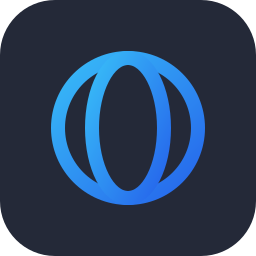

<h1 align="center">Soumyadip Adak</h1>

### 💫 About Me

```yaml
developer:
  name: Soumyadip Adak
  role: 😉
  primary_stack: [Java 21, Spring Boot, PostgreSQL, Docker, React]
  mindset: "Build, break, optimize, scale."
  passions: [Distributed Systems, High-Performance Microservices, AI/RAG Integration]
```

I am a **Software Engineer** focused on building reliable, high-throughput backend services and end-to-end full-stack applications. With a primary specialization in the **Java & Spring ecosystem**, I design architectures that emphasize maintainability, data integrity, and distributed performance.

- 🔭 **Backend Focus:** Building enterprise RESTful microservices, event-driven pipelines, and relational database schemas with **Spring Boot**, **PostgreSQL**, and **Docker**.
- 🧠 **AI & Innovation:** Integrating semantic vector search and Retrieval-Augmented Generation (RAG) using **Spring AI** and **pgvector**.
- 🎨 **Full-Stack Capability:** Crafting responsive, component-driven client interfaces using **React**, **Next.js**, and **Tailwind CSS**.
- 📐 **Core Disciplines:** Deeply rooted in CS fundamentals — Data Structures & Algorithms, Object-Oriented Design (SOLID), and System Architecture.

---

### 💻 Tech Stack

<div align="center">

  <p>
    <a href="https://skillicons.dev">
      <picture>
        <source media="(prefers-color-scheme: dark)" srcset="https://skillicons.dev/icons?i=java,spring,nodejs,express,postgres,mysql,mongodb,redis,kafka&theme=dark">
        <source media="(prefers-color-scheme: light)" srcset="https://skillicons.dev/icons?i=java,spring,nodejs,express,postgres,mysql,mongodb,redis,kafka&theme=light">
        
      </picture>
    </a>
  </p>

  <p>
    <a href="https://skillicons.dev">
      <picture>
        <source media="(prefers-color-scheme: dark)" srcset="https://skillicons.dev/icons?i=react,nextjs,ts,js,tailwind,html,css&theme=dark">
        <source media="(prefers-color-scheme: light)" srcset="https://skillicons.dev/icons?i=react,nextjs,ts,js,tailwind,html,css&theme=light">
        
      </picture>
    </a>
  </p>

  <p>
    <a href="https://skillicons.dev">
      <picture>
        <source media="(prefers-color-scheme: dark)" srcset="https://skillicons.dev/icons?i=docker,aws,linux,git,github,postman,py,c&theme=dark">
        <source media="(prefers-color-scheme: light)" srcset="https://skillicons.dev/icons?i=docker,aws,linux,git,github,postman,py,c&theme=light">
        
      </picture>
    </a>
  </p>

</div>

---

### ⚡ Architectural Mindset & Focus

```java
package dev.soumyadip;

import java.util.List;

public record EngineeringPhilosophy(
    String developer,
    String primaryFocus,
    List<String> corePillars,
    String mission
) {
    public static void main(String[] args) {
        var profile = new EngineeringPhilosophy(
            "Soumyadip Adak",
            "Enterprise Java & Distributed Systems",
            List.of(
                "Clean Architecture & Domain-Driven Design (DDD)",
                "Robust Microservices with Spring Boot & Kafka",
                "Database Performance Tuning & Vector Embeddings",
                "Containerization, Scalability & Cloud Readiness"
            ),
            "Translating complex system challenges into elegant, resilient software."
        );

        System.out.printf("🚀 %s | %s%n", profile.developer(), profile.primaryFocus());
        profile.corePillars().forEach(pillar -> System.out.println(" ⚙️ " + pillar));
    }
}
```

---

### 🌱 Continuous Learning & Evolution

<div align="center">

| 🎯 High-Priority Deep Dives | 🧭 Future Frontiers |
| :--- | :--- |
| 🔹 **High-Level System Design (HLD)** — Distributed caching, sharding, and consensus | 🔮 **Kubernetes & Cloud Orchestration** — Production deployments & Helm charts |
| 🔹 **Spring AI & Vector Databases** — Deep RAG pipelines and intelligent agent workflows | 🔮 **DevSecOps & Zero-Trust Security** — Automated CI/CD security scanning & secrets governance |
| 🔹 **Kafka Event Streams** — Event sourcing, CQRS patterns, and consumer group balancing | 🔮 **Graph Databases (Neo4j)** — High-connectivity social and knowledge graph modeling |

</div>

---

### 📫 Connect & Collaborate

<div align="center">

Let's discuss distributed systems, backend engineering, open-source projects, or potential opportunities.

<p align="center">
  <a href="https://www.linkedin.com/in/soumyadip-adak-a19b03281" target="_blank">
    <picture>
      <source media="(prefers-color-scheme: dark)" srcset="https://skillicons.dev/icons?i=linkedin&theme=dark">
      <source media="(prefers-color-scheme: light)" srcset="https://skillicons.dev/icons?i=linkedin&theme=light">
      
    </picture>
  </a>&nbsp;&nbsp;
  <a href="mailto:work.soumyadipadak@gmail.com">
    <picture>
      <source media="(prefers-color-scheme: dark)" srcset="https://skillicons.dev/icons?i=gmail&theme=dark">
      <source media="(prefers-color-scheme: light)" srcset="https://skillicons.dev/icons?i=gmail&theme=light">
      
    </picture>
  </a>&nbsp;&nbsp;
  <a href="https://hisoumya.in" target="_blank">
    <picture>
      <source media="(prefers-color-scheme: dark)" srcset="web-dark.svg">
      <source media="(prefers-color-scheme: light)" srcset="web-light.svg">
      
    </picture>
  </a>&nbsp;&nbsp;
  <a href="https://github.com/soumyadip-adak99" target="_blank">
    <picture>
      <source media="(prefers-color-scheme: dark)" srcset="https://skillicons.dev/icons?i=github&theme=dark">
      <source media="(prefers-color-scheme: light)" srcset="https://skillicons.dev/icons?i=github&theme=light">
      
    </picture>
  </a>&nbsp;&nbsp;
  <a href="https://www.instagram.com/soumyadip_adak8888" target="_blank">
    <picture>
      <source media="(prefers-color-scheme: dark)" srcset="https://skillicons.dev/icons?i=instagram&theme=dark">
      <source media="(prefers-color-scheme: light)" srcset="https://skillicons.dev/icons?i=instagram&theme=light">
      
    </picture>
  </a>&nbsp;&nbsp;
</p>

</div>

---

<div align="center">
  
  <br>
  <p>
    <em>"Great software is built where strong fundamentals meet thoughtful system design."</em>
  </p>
  <sub>Crafted with passion & engineering precision by <strong>Soumyadip Adak</strong>.</sub>
</div>
